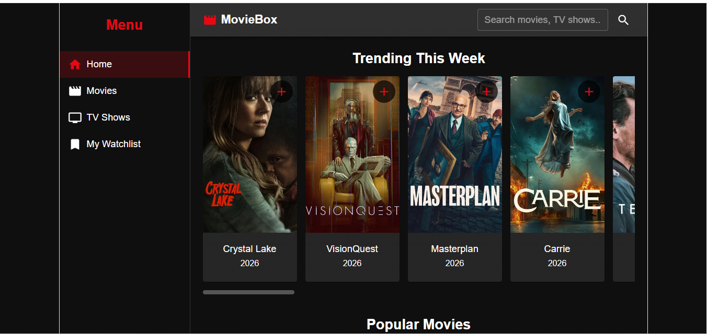
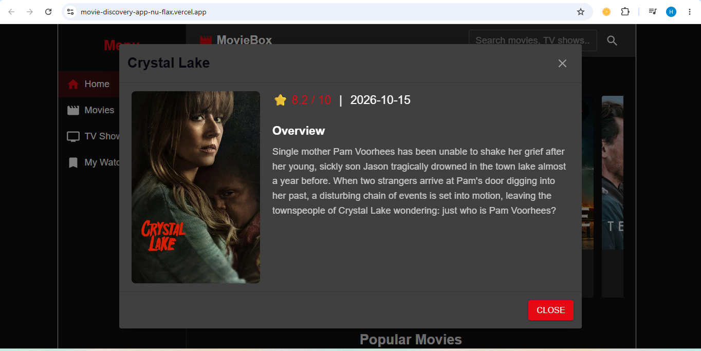

# MovieBox - Movie Discovery App

A responsive movie discovery application built with React, Vite, and Material UI. Users can browse trending movies and TV shows, search for titles, view detailed information, and save items to a personal watchlist.

**Live Application Link:** [https://movie-discovery-app-nu-flax.vercel.app/](https://movie-discovery-app-nu-flax.vercel.app/)

## Technologies Used
- React (Vite)
- Material UI (MUI)
- React Router
- Axios
- TMDB API

## Features
- **Home Page:** Displays Trending, Popular Movies, and Popular TV Shows.
- **Search:** Search for movies and TV shows by title in real-time.
- **Details Modal:** Click any poster to view its overview, rating, release date, and genres.
- **Watchlist:** Add or remove items. Saved to `localStorage` so it persists on refresh.
- **Responsive Design:** Works on desktop, tablet, and mobile screens.

## How to Run Locally
1. Clone the repository.
2. Run `npm install` to install dependencies.
3. Create a `.env` file in the root directory and add your TMDB API key:
   `VITE_TMDB_API_KEY=your_api_key_here`
4. Run `npm run dev` to start the development server.
5. Open `http://localhost:5173` in your browser.

## Screenshots
### Homepage

### Movie Details

## API Attribution
This product uses the TMDB API but is not endorsed or certified by TMDB.
